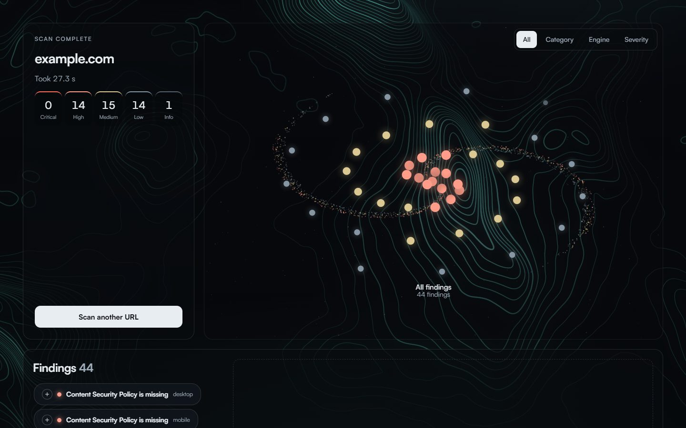
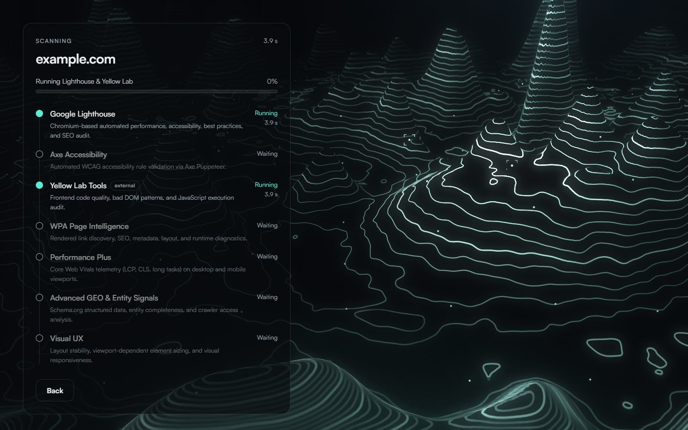
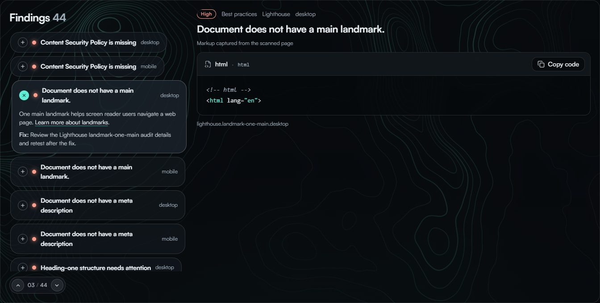

# WebPage Analyzer

Paste a public URL, and seven audit engines look at it from different angles: performance, accessibility, SEO, front-end quality, layout and what a crawler sees. The findings come back as one map you can explore, each with the evidence behind it.

**Try it: [wpa.onuracar.dev](https://wpa.onuracar.dev)** · no account, no cookies.



---

## What's in this repository

| Folder | What it is | Status |
| --- | --- | --- |
| [`lite/`](lite) | **WPA Lite**: the account-free scanner above. Express backend, React frontend, Docker deploy. | Live at [wpa.onuracar.dev](https://wpa.onuracar.dev) |
| `backend/`, `website/`, `frontend/`, `infra/` | The **full platform**: accounts, workspaces, PostgreSQL job queue, site crawling, passive security scans, AI remediation, billing adapters. | Code only, not deployed publicly ([details](docs/PLATFORM.md)) |
| [`docs/`](docs) | Design notes, reliability reports and the full platform guide. | |

Most of this README is about WPA Lite, because that is the part you can use.

## How a scan works

1. **You paste a URL and confirm you may test it.** The backend checks that it is a public `http(s)` address on port 80 or 443, then follows redirects itself (`example.com` → `www.example.com`), validating every hop.
2. **The scan joins a queue.** One scan runs at a time; the page shows your position.
3. **Seven engines run** while the timeline updates live:

   | Engine | Looks at |
   | --- | --- |
   | Google Lighthouse | Performance, accessibility, best practices and SEO, on desktop and mobile |
   | axe | WCAG accessibility rules |
   | Yellow Lab Tools | Front-end code quality and DOM patterns (third-party service, runs on their servers) |
   | WPA Page | Rendered SEO, metadata, headers, layout and runtime errors |
   | Performance+ | Core Web Vitals (LCP, CLS, long tasks) per viewport |
   | Advanced GEO | Structured data, entity signals, `robots.txt` and `llms.txt` |
   | Visual UX | Layout stability, element sizing across viewports and low-contrast text |

4. **Findings land on a map.** Group them by category, engine or severity; click one to see the markup captured from the page, or the raw evidence the engine reported. Nothing is generated or guessed.
5. **Results are kept for 30 minutes** in memory, then deleted.

| Scanning | Evidence for a finding |
| --- | --- |
|  |  |

### What it deliberately doesn't do

The full platform can also crawl whole sites, run passive security scans (OWASP ZAP) and replay user journeys. Those touch a site much harder, so they require proving you own the domain with a DNS record. WPA Lite has no accounts, so it leaves them out and only runs engines that are fine against any public page.

## Security

Anyone can make this server open any URL in a browser. That shapes most of the design:

- **No path to private networks.** Every browser connection goes through a proxy that resolves DNS itself and connects to the checked address, so DNS rebinding and redirects to `127.0.0.1`, `10.x` or cloud metadata are refused. The redirect resolver pins its connections the same way.
- **The container is the boundary.** Chromium runs without its own sandbox (it can't start one inside this hardened container), so the container is locked down instead: non-root, all capabilities dropped, read-only filesystem, CPU and memory limits, and firewall rules that block it from opening new connections to private ranges or to the host (the only thing it can still reach internally is its own nginx front end, see [DEPLOY.md](lite/deploy/DEPLOY.md)).
- **Nothing worth stealing.** The backend holds no API keys or credentials. The contact page opens your own mail app instead of sending mail from the server.
- **Abuse limits.** Per-IP rate limit, a 10-minute cooldown per scanned host, a daily cap and a bounded queue.
- **Behind Cloudflare only.** The server accepts web traffic only from Cloudflare's ranges, over an origin certificate checked in Full (strict) mode.
- **No tracking.** No analytics, no cookies. Logs keep a salted hash of the IP address, never the address itself.

Engine images are rebuilt weekly so Chromium stays patched; the host applies security updates on its own.

## Measured on the live server

One VDS: 4 vCPU (Intel Xeon Gold 6240R), 6 GB RAM, Ubuntu 24.04, Docker. Peak values from `docker stats`, sampled every 2 s, October 2026.

| Target | Engines completed | Scan time | Peak memory | Peak CPU |
| --- | --- | --- | --- | --- |
| example.com | 7 / 7 | 26–27 s | 543 MiB | 250 % |
| www.onuracar.dev | 7 / 7 | 98 s | 1.07 GiB | 357 % |

Scan time depends mostly on the target: heavier pages take longer for every browser engine.

## Run it locally

You need Node.js 22.19+ and Chrome or Chromium.

```bash
cd lite/backend
npm ci
npm start            # API on http://localhost:8080
```

```bash
cd lite/web
npm ci
npm run dev          # http://localhost:5173, proxies /api to the backend
```

Local defaults are strict (3 scans an hour per IP, 10-minute host cooldown). For development you can relax them in `lite/backend/.env`, see [`environment.template`](lite/backend/environment.template).

## Tests

```bash
cd lite/backend && npm test              # 44 tests: API, SSRF guards, redirects, queue, limits
cd lite/web && npm test                  # 39 tests: polling state machine, map layout, evidence, mailto
cd lite/web && npx playwright test       # 8 end-to-end tests against a mocked API
```

None of them start a real browser scan or touch the network.

## Deploy

[`lite/deploy/DEPLOY.md`](lite/deploy/DEPLOY.md) walks through the whole server setup in order: Docker Compose, the egress firewall, the weekly rebuild timer, Caddy with a Cloudflare origin certificate, locking ports 80/443 to Cloudflare, how to verify each step and how to roll it back.

## Built with

- **Backend:** Node.js, Express 5, Lighthouse, axe-core, Puppeteer, Playwright
- **Frontend:** React 19, Vite, TypeScript, Motion; the findings map is a hand-written Canvas 2D component
- **Infrastructure:** Docker Compose, nginx, Caddy, Cloudflare, Ubuntu 24.04

Third-party UI pieces (the Topography background from React Bits, components from Arc UI, an accordion adapted from useLayouts, the Satoshi typeface) are listed with their licenses in [`lite/web/CREDITS.md`](lite/web/CREDITS.md).

## Limits

- An automated scan is a starting point, not an audit or a compliance certificate.
- Your URL is also sent to Yellow Lab Tools, which loads the page from its own servers.
- One scan runs at a time, so busy moments mean a short queue.
- Results live in memory; a server restart clears them.

## License

[MIT](LICENSE) © Onur Acar. Found a problem or saw unexpected traffic from the scanner? Use the [contact page](https://wpa.onuracar.dev/contact).
